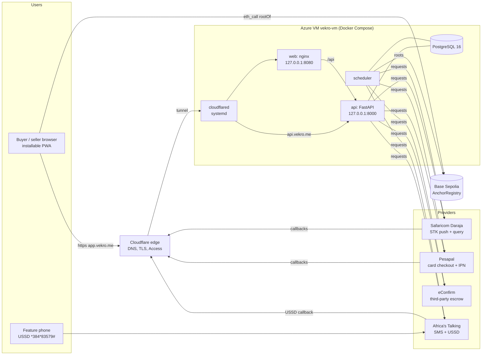

# Report evidence pack (Chapters 4–6)

Facts measured from the two repositories and from runs on the live system, for the capstone report.
Every number below has a date and a source. Re-run the commands to refresh them. Cyprian writes the
prose; this is the evidence.

- Backend: CKmellow/Vekro-backend, main @ `fdcf7a9` (2026-11-11).
- Frontend: CKmellow/Vekro, main @ `d770267` (2026-11-11).
- Live: https://app.vekro.me, https://api.vekro.me (Azure VM `vekro-vm`, South Africa North).

## 1. Final architecture

### Components

| Component | What it is | Where |
|---|---|---|
| Web app | React + Vite + TypeScript PWA (MVC: models, controllers, views), served by nginx, which also proxies `/api` | `ghcr.io/ckmellow/vekro-web`, container `web` |
| API | FastAPI (Python 3.12), state machine, escrow ledger, payment rails, USSD, anchoring verification | `ghcr.io/ckmellow/vekro-api`, container `api` |
| Scheduler | Same image, `python -m app.jobs.scheduler`: anchoring, payouts, payment confirmation (Daraja, Pesapal, eConfirm), timeouts, liabilities and reserves snapshots; Postgres advisory locks | container `scheduler` |
| Database | PostgreSQL 16: users, orders, double-entry ledger, append-only money audit and anchor event chain | container `postgres` |
| Public record | `AnchorRegistry` (Solidity, Foundry) on Base Sepolia; stores Merkle roots only | `0xD8094faf2B44711dD372A59C288130FA8113E4DB` |
| Payment rails | Daraja STK push (M-Pesa), Pesapal hosted card checkout, eConfirm third-party escrow (tier 1), simulated rail (development and CI) | `app/services/custody/`, `app/services/daraja*.py`, `card_payments.py` |
| Messaging | Africa's Talking SMS and USSD (`*384*83579#`, sandbox) | `app/services/ussd.py`, `sms*.py` |
| Edge | Cloudflare (DNS, TLS, tunnel `vekro-vm`, Access for SSH, Email Routing for `support@vekro.me`) | Cloudflare account |

### Deployment

The VM has no inbound rule. All traffic arrives through the outbound Cloudflare tunnel, and SSH goes
through Cloudflare Access (`docs/hosting.md` 4.3). The browser reads the anchored roots from Base
Sepolia directly, never from Vekro's API.

## 2. Tests

Measured 2026-11-11 on the laptop (WSL2) unless the source says CI.

| Suite | Command | Result | Coverage |
|---|---|---|---|
| Backend unit and integration | `.venv/bin/python -m coverage run --source=app -m pytest -q` | **1139 passed, 18 skipped** | **91%** of `app/` (13,349 statements, 1,198 missed) |
| Backend on PostgreSQL | `TEST_POSTGRES_URL=… pytest -m postgres` (scratch DB at head) | **11 passed** | (part of the above) |
| Backend chain (local Anvil) | `pytest -m chain` | **5 passed** | (part of the above) |
| Smart contract | `cd contracts && forge test` | **16 passed** in 2 suites (15 unit, 1 invariant) | – |
| Frontend unit and view | `npx vitest run --coverage --maxWorkers=2` | **849 passed** | **94.67%** statements and lines, 87.15% branches, 83.23% functions |
| Frontend end-to-end | CI job "End-to-end (Playwright, real backend)", run 43028887340 on `d770267` | **22 passed, 1 skipped** (real backend, PostgreSQL; includes the real Pesapal sandbox card flow and the service-worker deploy test) | – |

Skipped backend tests are the opt-in live-provider tests (`-m live`: Daraja, Pesapal, eConfirm,
LOOP), which need real credentials and, for eConfirm, real money. Under coverage instrumentation
with full parallelism, a few frontend tests timed out on the laptop (a different few each run).
With two workers all 849 passed, and they all pass without coverage and in CI. This is noted,
not hidden.

The skipped count is 18 at `929b2fc`. The count was 15 on 2026-11-08, when there were 910 tests in
total (`LOCAL_EXECUTION_PLAN.md`).

## 3. Continuous integration

| Repository | Workflow | Jobs |
|---|---|---|
| Backend | CI (every PR and push to main) | Lint (ruff); Tests (pytest); Migrations (PostgreSQL: upgrade, downgrade, re-upgrade); Contracts (Foundry, pinned v1.7.1, sha256-checked); Anchoring on Anvil (`-m chain`); Docker image and Compose (build, config check, secret scan) |
| Backend | Deploy (push to main) | Build and push `vekro-api:<sha>` to GHCR after a secret scan; roll-out to the VM by `deploy/deploy.sh` (by hand while `DEPLOY_ENABLED` is unset; `docs/hosting.md` 7.1) |
| Frontend | CI | Lint, typecheck, unit tests, build, bundle budgets, API types match `api/openapi.json`; End-to-end (Playwright against a real backend and PostgreSQL); Web image (build, nginx config check, secret scan) |
| Frontend | Deploy | Build and push `vekro-web:<sha>` (stamped with the commit) after a secret scan |

Both pipelines were green on main on 2026-11-11 (backend run 43017753692, frontend run
42996563525). Every PR was squash-merged only with green CI. One delayed trigger (2026-11-10) is
documented in `docs/hosting.md` 7.1.

## 4. Security measures and the tests that prove them

| Measure | Proved by |
|---|---|
| Server-side sessions; CSRF token bound to the session, header must match the cookie | `test_auth_security_guards.py::test_issued_csrf_token_is_only_valid_for_its_own_session`, `::test_middleware_rejects_csrf_header_that_differs_from_cookie`; `test_auth_login_logout.py::test_logout_missing_csrf_header_is_rejected` |
| Passwords hashed with Argon2, never stored in plain text | `test_password_hashing.py::test_hash_password_never_stores_plaintext`, `::test_argon2_hash_does_not_require_upgrade` |
| Login rate limit and account lockout | `test_auth_login_logout.py::test_login_rate_limited_returns_429`, `::test_login_locked_account_returns_429`; `test_auth_security_guards.py::test_account_locks_after_configured_failures_and_rejects_correct_password` |
| A payment callback is only a trigger: Vekro funds only after its own provider query | `test_daraja.py::test_a_callback_the_query_does_not_confirm_never_locks`, `::test_a_confirmed_callback_locks_and_funds_even_in_production` |
| Card funding only on COMPLETED, exact amount and reference; replays change nothing | `test_card_payments.py::test_a_completed_payment_that_does_not_match_is_refused_and_audited`, `::test_a_completed_payment_funds_the_order_and_a_replayed_ipn_changes_nothing`, `::test_an_ipn_for_an_unknown_order_is_refused` |
| Append-only money history (database triggers) | `test_anchor_postgres.py::test_the_append_only_triggers_refuse_edits` (PostgreSQL suite) |
| Tamper evidence: any later edit is detected against the public roots | `test_anchoring_verification.py::test_an_edited_payload_in_the_bundle_is_tampered`, `::test_a_different_root_on_chain_is_tampered`, `::test_a_status_set_without_a_transition_is_tampered`, `::test_an_edited_ledger_row_is_caught_by_the_full_audit` |
| Anchor-before-payout gate; an edited payout halts and never pays | `test_anchoring_payout_gate.py::test_a_payout_edited_after_its_anchor_halts_and_never_pays`, `::test_a_root_that_differs_on_chain_halts_the_payout`, `::test_the_gate_needs_anchoring_and_production_needs_the_gate` |
| No personal data in anchored payloads (keyed provider refs, suite-wide guard) | `tests/pii_guard.py` (applied to every anchored payload by `conftest.py`); `test_anchoring_verification.py::test_the_public_batch_read_has_no_personal_data`; `test_payment_switch.py::test_the_switch_is_anchored_without_personal_data` |
| Key rotation keeps old records verifiable | `test_admin_ref_rotation.py::test_dropping_the_old_key_is_still_caught` |
| USSD: secret path token, PIN with a 3-strike lock, the delivery code for acceptance | `test_ussd.py::test_a_wrong_pin_changes_nothing_and_three_lock_ussd`, `::test_a_wrong_delivery_code_changes_nothing`, `::test_router_refuses_a_wrong_token_or_when_off` |
| USSD caller IP only from Cloudflare's `CF-Connecting-IP` behind a private hop (#289) | `test_ussd.py::test_router_allowlist_reads_cf_connecting_ip_only_from_a_private_hop`, `::test_router_allowlist_is_off_unless_the_tunnel_header_is_configured` |
| eConfirm confirmation code encrypted at rest; startup refuses without a valid key | `test_econfirm_crypto.py::test_startup_refuses_when_enabled_without_key`, `::test_startup_refuses_when_enabled_with_invalid_key` |
| Demo shortcuts refused in production | `test_scheduler.py::test_demo_fast_timeouts_are_refused_in_production`; `test_demo_reset.py::test_it_refuses_without_the_explicit_confirmation` |
| Web: strict CSP, no session in browser storage, no raw HTML | frontend `src/app/security.test.ts` (no raw HTML, storage, logging), `src/app/deploy.test.ts` (the CSP header equals the meta policy) |
| Web: security headers on every response (HSTS, CSP, nosniff, frame and referrer policy) | frontend `src/app/deploy.test.ts` ("sends the full security header set from every app location", #306); live check below |
| Continue with Google: PKCE (S256), single-use state bound to the browser, nonce; ID token verified (RS256, iss, aud, exp, nonce, verified e-mail) | `test_google_auth.py::test_the_request_carries_state_nonce_and_an_s256_challenge_of_a_server_side_verifier`, `::test_the_code_exchange_sends_the_pkce_verifier_and_a_wrong_one_is_refused`, `::test_a_replayed_callback_is_refused`, `::test_a_forged_state_is_refused`, `::test_a_token_with_another_nonce_is_refused`, `::test_id_token_claims_are_checked`, `::test_a_token_signed_by_another_key_is_refused` |
| Google accounts matched by subject only; no admin access unless linked; no seller before an SMS-verified phone; no Google tokens stored | `test_google_auth.py::test_a_matching_email_never_links_an_account`, `::test_an_unlinked_admin_is_never_signed_in_by_google`, `::test_a_google_seller_exists_only_after_the_sms_code`, `::test_routes_complete_a_seller_signup_and_block_selling_before_it`, `::test_a_buyer_links_google_and_only_sub_and_email_are_kept` |
| No secrets in the public images | CI step "No secrets in the image" (`scripts/scan-image-secrets.py --self-test` and a scan of each image) |

## 5. Live sandbox evidence

Sandbox rails unless stated. Times in UTC unless EAT is given.

| Date | What | Result |
|---|---|---|
| 2026-11-08 | Daraja sandbox STK, KES 1, both confirmation paths (callback; fallback query with the tunnel down) | Both orders funded (`docs/daraja-observed.md`) |
| 2026-11-09 | Pesapal sandbox card payments, KES 10 each, published test cards ...0010, ...1091 (3DS), ...1018 ("declined") | All three Completed. No 3DS challenge, and the "decline" card approved: sandbox behaviour (`docs/pesapal-observed.md` 8). Screenshots `card-1-completes-funded.jpg`, `card-2-3ds-card-funded.jpg`, `card-3-declined-card-funded-by-sandbox.jpg` |
| 2026-11-09 | Africa's Talking sandbox SMS | In the AT simulator inbox (`at-simulator-sms-inbox.jpg`); sandbox SMS never reaches real phones |
| 2026-11-10 | Go-live on vekro-vm: VK-BJNA8P, Daraja sandbox KES 1 to Cyprian's phone; callback reached api.vekro.me (200); dispatched, delivered, released | Receipt VERIFIED 10/10 against Base Sepolia; audit CLEAN 88 events in 26 batches; reboot recovery; backup and restore drill |
| 2026-11-11 | VK-2N6HSK (card, KES 10) finished over the real USSD endpoint: seller dispatch and arrival with PIN, buyer acceptance with the delivery code | Released; VERIFIED 10/10 |
| 2026-11-11 | **eConfirm live, real money**, VK-B627E5, KES 100: escrow funded by eConfirm's M-Pesa prompt (15:06 EAT), recorded by Vekro's reconciliation, delivered over USSD, released through eConfirm | eConfirm `Completed`; VERIFIED 55/55. Sanitised release request and response: `econfirm-release-VK-B627E5.sanitised.json`. Account of the run, including what went wrong: `docs/econfirm-live-runbook.md` |
| 2026-11-11 | Tamper demo on a copy of VK-BJNA8P's receipt (one amount edited) | Original VERIFIED; copy TAMPERED, `amount_mismatch` |
| 2026-11-11 12:49 | Full audit of the live database against Base Sepolia | **CLEAN: 324 events in 179 batches** |
| 2026-11-11 | Web delivery: an open browser tab moved to a new deploy by itself (#302); security headers 6 of 6 on every app path (#306); Chrome installability check with no errors (#304) | Live on app.vekro.me |
| 2026-11-11 | `support@vekro.me` (Cloudflare Email Routing) | Mail from an outside address arrived in the support inbox |
| 2026-11-11 | Continue with Google on app.vekro.me (consent screen in Testing): seller 310 linked a Google account from Settings, then signed in with it | Both worked (Cyprian, in his browser); the account stores only the Google subject and the e-mail |

Screenshots and sanitised bodies are in `docs/report-assets/` (git-ignored, so the folder stays
private). Frontend screenshots per issue are in the frontend repo, `docs/screenshots/`.

## 6. Public record

- Network: Base Sepolia (chain id 84532).
- `AnchorRegistry`: `0xD8094faf2B44711dD372A59C288130FA8113E4DB`, explorer:
  https://sepolia.basescan.org/address/0xD8094faf2B44711dD372A59C288130FA8113E4DB
- Anchorer address: `0x7fA0…E391` (`docs/hosting.md` 5). The only anchorer is the VM.
- What goes on-chain: one Merkle root per batch (no personal data), plus liabilities and reserves
  snapshot roots (`docs/anchoring.md` 4b, 4c).

## 7. Limitations and future work

- **Custody**: the M-Pesa demo money sits in a sandbox shortcode, and card money with Pesapal
  (collection, not custody). Only eConfirm is a third-party escrow, proved by one live KES 100 round
  trip. Production needs a licensed custodian and the agreements around it.
- **Sandbox only** for Daraja, Pesapal and Africa's Talking. Live keys, a registered SMS sender ID and
  a dedicated USSD code are not in place.
- **USSD callbacks are unsigned**, and the sandbox simulator lets anyone type any number. PIN and
  delivery code limit the damage, and the IP allowlist works only behind the tunnel.
- **The chain proves what Vekro recorded**, not that the money is at the provider. Proof of reserves
  needs the custodian's signed balance. Omissions from a seller's track record are not detectable.
- **Testnet**: Base Sepolia, not mainnet.
- **One VM**, stopped nightly at 23:00 EAT, with backups on the VM and copied by hand. There is no
  high availability, and CD roll-out stays manual until Cloudflare Access service tokens exist.
- **Observed gaps from the live runs**: the eConfirm runbook missed the payout settings (#320), and
  the payment page claimed "nothing was charged" after an expired prompt (frontend #308). Both are
  fixed and recorded.
- **Google sign-in is in Testing**: only listed test users can use it until Google verifies the app.
- **Future work**: proof of reserves signed by the custodian; mainnet anchoring with KMS-held keys;
  live rails; signed or operator-asserted USSD; Google sign-in out of Testing mode (Google's
  verification); off-VM backups and monitoring alerts.
